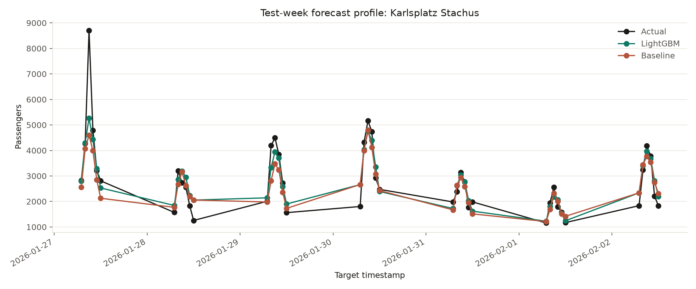
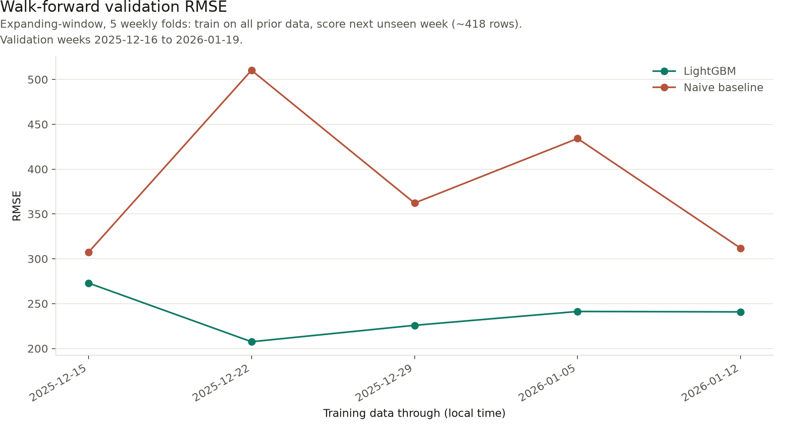
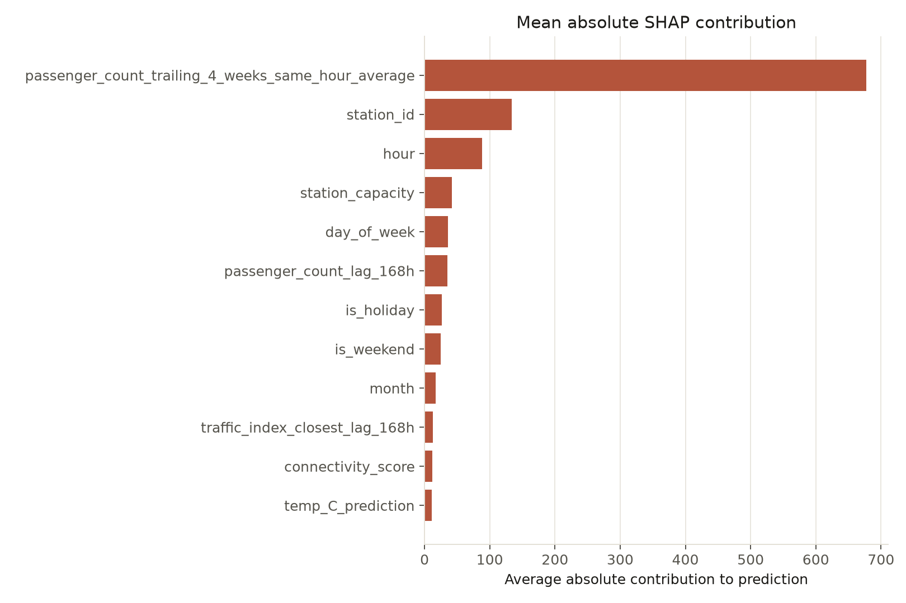

# Munich Subway Ridership Forecast

Forecast of hourly passenger entries per Munich subway station (07:00–12:00), **exactly 7 days ahead**, so operations can allocate staff and resources to the right stations a week in advance.

The data in `data/` is synthetic: 10 stations, hourly ridership from 2023 to early 2026, plus station metadata, hourly weather and road-traffic indices.

## Results

| | RMSE (last 7 days, 417 station-hours) |
|---|---|
| Naive baseline: trailing 4-week average, same station / weekday / hour | 319.8 |
| **LightGBM** | **272.1** (−15%) |

The improvement holds in an expanding-window walk-forward validation over 5 consecutive weeks: mean RMSE 238 vs. 385 for the baseline, and LightGBM wins every fold.




## Approach

- **Problem framing:** a fixed 168 h horizon. Every feature is restricted to what is known at forecast time (lags ≥ 168 h, weather *forecasts* for the target hour), so the evaluation is leakage-free.
- **Model:** a single global LightGBM regressor across all stations, with native categorical handling (no one-hot encoding).
- **Baseline:** deliberately strong. The trailing 4-week same-hour average is what an operations planner would do by hand, so beating it is a meaningful bar.
- **Explainability:** gain importance, SHAP and partial dependence. The model starts from the seasonal baseline and adds corrections for holidays, station size, hour of day, weather and traffic.



- **Production design** (in `notes.md`): daily inference job, a lagged-ground-truth monitoring job, and a champion/challenger retraining job with an MLflow model registry.

## Repository layout

```
subway_forecast_notebook.py   # jupytext notebook: EDA → features → training → evaluation → plots
data/                         # synthetic input tables
output/                       # CSV results (RMSE overall / per station, walk-forward, importances)
figures/                      # generated plots
problem.md                    # problem statement
notes.md                      # design notes: framing, features, model choice, deployment & monitoring
technology_readup.md          # background on the production tooling
```

## Run

Requires [uv](https://docs.astral.sh/uv/) and Python 3.13.

```bash
uv run python subway_forecast_notebook.py
```

To open it as a Jupyter notebook:

```bash
uv run --group dev jupytext --to ipynb subway_forecast_notebook.py
```
