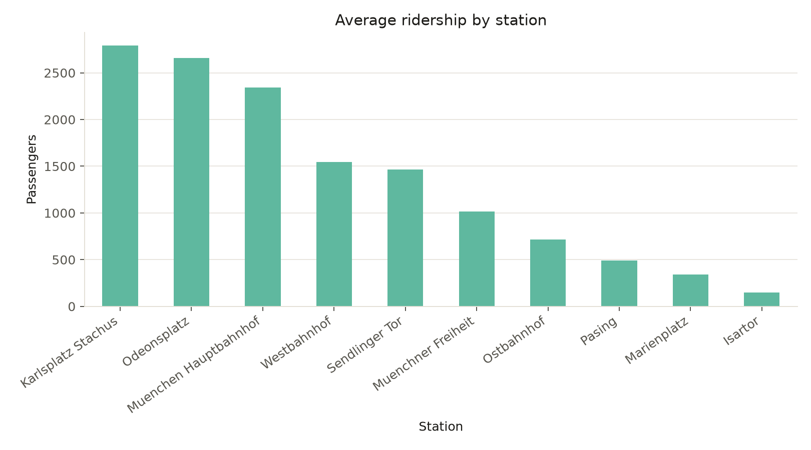

# Munich Subway Ridership Forecast — Notes

## Business context

## Problem interpretation 
The brief says "predict hourly passenger counts, 7 days ahead" — interpreted as a fixed 168h-ahead forecast, not a daily batch covering a mixed range of horizons.
Inference cadence: once per operating hour (6×/day, 7am–12pm), not daily and not 24×. Each run predicts exactly T_run + 168h.

### Formal setup

Three times define each forecast:

| Symbol | Meaning |
| --- | --- |
| $t_1$ | Training cutoff — last hour used to fit the model |
| $t_2$ | Inference time — when the forecast is issued |
| $t_3$ | Prediction target — the hour we predict |

At each hour $\tau$:

| Symbol | Meaning |
| --- | --- |
| $Y_\tau$ | Passenger count (the series we forecast) |
| $X_\tau$ | Exogenous inputs only — station metadata, weather, traffic, calendar (no passenger counts) |

**Constraints:** $t_1 \le t_2 < t_3$ and $t_3 = t_2 + 168\text{h}$.

Let $\mathcal{D}_\tau = \{(X_s, Y_s) : s \le \tau\}$ denote all data available through $\tau$. The goal is to learn, from $\mathcal{D}_{t_1}$, a model $f_{t_1}$ that maps information at inference to the target:

$$\hat{Y}_{t_3} = f_{t_1}(\mathcal{D}_{t_2})$$

In practice $f_{t_1}$ consumes engineered features derived from $\mathcal{D}_{t_2}$ (e.g. $Y_{t_2}$, $Y_{t_2 - 168\text{h}}$, trailing same-hour averages) rather than the raw history — but every such feature is a function of $\mathcal{D}_{t_2}$ only.

When $t_2 > t_1$, $\mathcal{D}_{t_2}$ includes observations strictly after the training cutoff. The model is not refit on that fresher data — it generalises from what it learned at $t_1$.

### Concrete timing example (matches the test holdout)

Three non-overlapping windows map directly to the three production jobs:

| Window | Local CET range | Role |
| --- | --- | --- |
| **Train** | 2023-01-01 07:00 → 2026-01-19 12:00 | Job 3 trains here. Everything the deployed model has ever seen. |
| **Inference window** | 2026-01-20 07:00 → 2026-01-26 12:00 | Job 1 runs here. Each T_run produces one 168h-ahead prediction. The model is NOT retrained during this window. |
| **Test / prediction targets** | 2026-01-27 07:00 → 2026-02-02 12:00 | The hours Job 1 is predicting. Actuals arrive here; evaluation happens after the window closes. |

Job 1 inference sequence during the inference window:

| T_run (local) | Predicts for (T_run + 168h) | Lag feature used (passenger_count_lag_168h) |
| --- | --- | --- |
| 2026-01-20 07:00 | 2026-01-27 07:00 | count at 2026-01-20 07:00 (current observation) |
| 2026-01-20 08:00 | 2026-01-27 08:00 | count at 2026-01-20 08:00 |
| … | … | … |
| 2026-01-26 12:00 | 2026-02-02 12:00 | count at 2026-01-26 12:00 (last inference run) |

Key property: every lag feature for a test row is computed from data available at T_run = T_target − 168h. The inference-window data (Jan 20–26 actuals) is never used for training — it only enters the evaluation as lag feature inputs at inference time. This is the same situation as production.

## Input data available features
`station_metadata`

| station_id | station_name | lat | lon | station_capacity | is_interchange | connectivity_score |
| --- | --- | --- | --- | --- | --- | --- |
| 1 | Muenchen_Hauptbahnhof | 48.1402 | 11.5586 | 5634 | 1 | 0.453 |
| 2 | Marienplatz | 48.1374 | 11.5755 | 1756 | 1 | 0.364 |
| 3 | Ostbahnhof | 48.1316 | 11.581 | 3752 | 1 | 0.676 |

`timeseries_with_target`

| station_id | timestamp | passenger_count |
| --- | --- | --- |
| 1 | 2023-01-01 07:00:00+01:00 | 1534.0 |
| 1 | 2023-01-01 08:00:00+01:00 | 2037.0 |
| 1 | 2023-01-01 09:00:00+01:00 | 1039.0 |

`traffic_hourly`

| timestamp | traffic_index | lat | lon |
| --- | --- | --- | --- |
| 2023-01-01 00:00:00+01:00 | 0.6855992113613605 | 48.141682 | 11.55934 |
| 2023-01-01 01:00:00+01:00 | 0.6861555439341888 | 48.141682 | 11.55934 |
| 2023-01-01 02:00:00+01:00 | 0.7212114211611421 | 48.141682 | 11.55934 |

`weather_hourly`

| timestamp | temp_C | precip_mm |
| --- | --- | --- |
| 2023-01-01 00:00:00+01:00 | 13.174782008197822 | 0.0 |
| 2023-01-01 01:00:00+01:00 | 17.30724831024602 | 0.0 |
| 2023-01-01 02:00:00+01:00 | 11.591382188684753 | 0.0 |

## Table added from internet
`holiday_calendar`
| date | is_holiday | is_octoberfest |
| --- | --- | --- |
| 2023-01-01 | ? | ?|

## Feature choice:

### Included features:
Features to include:
- `station_id` 
  - Categorical
- `station_capacity` (from station_metadata)
  - joined on `station_id` from `station_metadata`
  - see note below
  - numeric
- `is_interchange`
  - joined on `station_id` from `station_metadata`
  - see note below
  - Binary flag
- `connectivity_score`
  - joined on `station_id` from `station_metadata`
  - see note below
  - numeric
- `traffic_index_closest_lag_168h` 
  - closest traffic measurement to the station (spatial join on lat/lon)
  - L2 distance is fine at city level scale, no need for haversine
  - lagged by 168, latest available data at inference time for that hour's prediction
  - see note below
  - numeric
- `passenger_count_lag_168h`: same hour previous week
   - numeric
- `passenger_count_trailing_4_weeks_same_hour_average`
  - relative to target timestamp
  - same hour and same day-of-week across the last 4 weeks
  - numeric
- timestamp derived features 
  - `hour`: 
    - categorical
    - Only 6 levels (7–12)
    - probably we have a commute peak in there
    - Captures annual seasonality such as school holidays, winter/summer patterns, tourism, and event-season effects.
  - `month`
    - categorical
  - `is_holiday`: binary, based on a list of public holidays in Bavaria.
    - has to be downloaded once and stored in the Data Lake, updated yearly.
    - Binary flag
  - `is_octoberfest`: binary, based on the official Oktoberfest schedule.
    - has to be downloaded once and stored in the Data Lake, updated yearly.
    - Binary flag
  - `day_of_week`
    - Categorical
  - `is_weekend` 
    - Technically, this is redundant with `day_of_week`. 
    - It's the difference between the model finding that split once near the root vs. having to rediscover it repeatedly across many trees/branches when it interacts with other features
    - It's essentially free — one redundant near-binary column doesn't meaningfully hurt a tree model
    - Binary flag
- `temp_C_prediction`, `precip_mm_prediction`
  - both numeric
  - joined on timestamp of the predicted hour from `weather_hourly` API
  - At training time, weather_hourly only contains realized, actual weather. 
  - At inference time, it contains noisy weather forecasts 
  - We inject calibrated forecast-error noise into the training join to avoid overweight
  - Lets assume a small Gaussian noise with mean 0 and stddev equal 1/5 of stdev `temp_C` and `precip_mm` in the training data, respectively.

#### Note on station meta features: station_capacity, is_interchange, connectivity_score, traffic_index_closest_lag_168h
with only 10 stations, station_id can fully memorize per-station base rates, but the continuous features let the model generalize interaction effects (e.g., capacity × hour-of-day) more smoothly than a categorical split can, and they're what would let the model extrapolate to a new station added later. 

### Explicitly not included:
- `year` constant in the dataset

## Model choice

### LightGBM
- Actual model: gradient-boosted trees (LightGBM).
- We train with `objective='regression'`, because the task is evaluated on RMSE. `objective='tweedie'` would actually be more appropriate for count data.
- Validation strategy: Expanding-window walk-forward validation
- Use LightGBM's native `categorical_feature` parameter for categorical variables.
- Why?
  - LightGBM is the industry standard and likely more powerful.
  - LightGBM dominates many relevant Kaggle competitions.
  - Gradient-boosted trees are a strong tabular-data baseline and are widely used in production because they are accurate, fast, and explainable.
  - Mixed feature types, no preprocessing gymnastics.
  - You've got categorical (`station_id`), small integer counts (`num_lines_served`, `scheduled_trains`), and continuous signals (`temperature`, lags) all in one row. Tree-based GBMs split on these natively.
  - Learns interactions you'd otherwise have to hand-engineer.
  - Sample-efficient at this scale.
  - Transformers would need a lot more data.
  - While we do use RMSE here as per the task definition, `passenger_count` is right-skewed/zero-inflated. LightGBM supports Poisson/Tweedie objectives out of the box, which fit count data better than squared-error loss on a linear model.
  - Cheap to retrain weekly.
  - Built-in interpretability.
  - Feature importance / SHAP come for free.

### Naive Choice
- Historical average for that station and hour, for example average of all past 8am observations for `MUC001`.
- Should be a strong baseline given the regularity of transit demand patterns.
- "Naive" does not mean weak here. It means the baseline does not learn multivariate effects or use external covariates; it only encodes historical seasonality by station and hour.
- For commuter traffic this is already a demanding benchmark, because much of the signal is regular calendar behavior.

### Smart Naive choice
- Historical average for that station, day of week, and hour.
- This is a stronger seasonal baseline than `station + hour`, because it distinguishes, for example, Monday 8am from Saturday 8am.
- It is still interpretable and operationally trivial to maintain.
- It remains limited to historical seasonality and still cannot react to weather, traffic, holidays, station metadata, or recent lag interactions the way LightGBM can.

### Naive choice 2

exactly `passenger_count_trailing_4_weeks_same_hour_average`

### One-line contrast to alternatives (good for an anticipated pushback slide/footnote)

Linear regression: too rigid for interaction effects, would need extensive manual feature crosses.
Per-station classical time series (ARIMA/Prophet): univariate by design — can't easily share patterns across stations or ingest weather/traffic as regressors; you'd need 10 separate models instead of one.
Deep learning (LSTM/TFT): more data-hungry, harder to explain to ops stakeholders, and the added complexity isn't earned at this data volume.
Naive baseline: good sanity check, but can't use weather/traffic signals — that's exactly the gap LightGBM closes.

## Evaluation results
### Headline
LightGBM is the best model on the final 7-day holdout, but the important management conclusion is more nuanced: most of the forecasting power comes from regular station/weekday/hour seasonality.

| Model | Overall RMSE | Relative to naive | Comment |
| --- | ---: | ---: | --- |
| Naive baseline: station + hour mean | 512.1 | baseline | Useful sanity check, but ignores weekday effects |
| Smart naive: station + weekday + hour mean | 288.0 | -43.8% | Very strong because subway demand is highly periodic |
| LightGBM regression | 277.7 | -45.8% | Best holdout result; +3.6% better than smart naive |

Test-set details:
- Expected holdout size: 10 stations × 6 operating hours × 7 days = 420 rows.
- Evaluated rows: 417; 3 rows have missing actuals and are excluded from RMSE.
- Best LightGBM iteration: 505.

### Interpretation
LightGBM clearly beats the simple naive baseline (`512.1 -> 277.7` RMSE), so the model is learning substantially more than a station/hour average.

The smart naive baseline is close (`288.0` RMSE), which is plausible and actually reassuring: it means the dominant signal in this dataset is operationally intuitive, namely "what normally happens at this station on this weekday and hour." For a CEO-level story, I would frame this as: the ML model wins, but the business is predictable enough that a transparent seasonal baseline is already hard to beat.

### Per-station result
LightGBM beats the simple naive baseline for every station.

| Station | LightGBM RMSE | Naive RMSE | Smart naive RMSE | Readout |
| --- | ---: | ---: | ---: | --- |
| Isartor | 19.2 | 44.9 | 17.7 | Smart naive slightly best |
| Marienplatz | 41.6 | 107.4 | 55.6 | LightGBM best |
| Pasing | 77.7 | 108.3 | 95.9 | LightGBM best |
| Muenchner_Freiheit | 157.9 | 297.0 | 136.1 | Smart naive best |
| Sendlinger_Tor | 187.1 | 520.7 | 185.3 | Roughly tied with smart naive |
| Westbahnhof | 199.4 | 481.9 | 227.9 | LightGBM best |
| Ostbahnhof | 214.3 | 237.6 | 212.3 | Roughly tied with smart naive |
| Muenchen_Hauptbahnhof | 261.8 | 534.7 | 368.9 | LightGBM best |
| Odeonsplatz | 332.0 | 679.1 | 324.8 | Roughly tied with smart naive |
| Karlsplatz_Stachus | 661.6 | 1096.4 | 652.3 | Roughly tied with smart naive |

The main risk is not "LightGBM fails"; it is "LightGBM only marginally improves over a very strong seasonal baseline on this short holdout." I would therefore position the smart naive model as the production fallback and monitoring benchmark. If LightGBM stops beating it over a rolling window, automatically fall back or retrain.

### Expanding-window walk-forward validation

**Terminology, defined once, used precisely from here on:**
- *Walk-forward validation* (the general family): never train on the future; always validate on a block of time that comes after training, then step forward through history. Plain k-fold would shuffle rows randomly and leak future information into the training set — not valid for time series.
- *Expanding-window* (the specific variant used here): each fold's training set keeps **everything** before the validation week, so it grows fold over fold, rather than a fixed-size window that slides forward and drops old data (that alternative is the "rolling/sliding-window" variant — not what's implemented here, and a term I'm deliberately not reusing elsewhere in these notes to avoid implying the wrong one). `sklearn.model_selection.TimeSeriesSplit` implements this same expanding-window scheme.

**One model per fold, not one model per operating hour.** Each fold trains a single LightGBM model and scores it against *every* row in that week's validation set — all 6 operating hours × 7 days × 10 stations (~420 rows), not 6 separate per-hour models. This is the correct design, for two reasons:
- Every row's lag features (`passenger_count_lag_168h`, `passenger_count_trailing_4_weeks_same_hour_average`, the weather/traffic joins, ...) are computed relative to *that row's own timestamp*, using only data that would have been available 168h earlier. So a Monday-8am row and a Thursday-11am row inside the same fold are each an honest stand-in for "what Job 1 would have predicted if it had run at that specific T_run" — the row, not the fold, is the unit of simulated production use.
- `hour` is a categorical feature the model splits on directly, so hour-of-day effects are learned inside one model rather than requiring six separate hour-specific models.
- Consequence: we never retrain at inference time. Job 1 (hourly inference, 6×/day) always scores against whichever model currently holds the Production alias; Job 3 (retraining) runs weekly and only promotes a new champion if it beats the current one on holdout RMSE.

**Why weekly folds are the right backtest unit, not an arbitrary choice.** The fold boundary matches the retrain boundary by construction: in production, Job 3 retrains weekly, and Job 1 then reuses that one fixed model for every inference call (≈42 of them — 6 hours × 7 days) until the next retrain. A weekly expanding-window fold reproduces exactly that pattern — "train once, then serve every call until the next retrain" — so the backtest matches the deployed system rather than a CV scheme invented independently of it. (This is also why a single 168h-ahead model is sufficient in the first place: 168h is an exact multiple of 24h, so T_run + 168h always lands on the same hour-of-day, 7 days later — there's no cross-hour horizon mismatch to design around.)

Across five folds, LightGBM is consistently better than the simple naive baseline:

| Fold | LightGBM RMSE | Naive RMSE | Smart naive RMSE |
| ---: | ---: | ---: | ---: |
| 1 | 207.5 | 508.7 | 474.1 |
| 2 | 225.8 | 532.0 | 392.7 |
| 3 | 241.3 | 479.3 | 387.8 |
| 4 | 240.8 | 471.4 | 223.7 |
| 5 | 242.9 | 466.4 | 259.7 |

This supports model stability: LightGBM is not just winning on one lucky split.

Mechanics, concretely, per fold:
1. Pick one calendar week as validation.
2. Train on all data strictly before that week (expanding window — see terminology above).
3. Score the resulting single model on every station/day/hour row in that unseen week.
4. Move to the next calendar week and repeat.

Fold 1 trains on 64,771 non-missing target rows; fold 5 trains on 66,441 — a difference of only 1,670 rows, or four extra weeks, on top of roughly three years of history. So training-set size growth alone is probably not what's driving the fold-to-fold differences below.

The stronger interpretation is that each validation fold is a different real calendar week. The smart naive baseline only predicts from historical averages for the same station, weekday, and hour, so it performs very well when the validation week looks like the historical average. But if a week is unusual, for example around Christmas / New Year or because of weather, events, or station-specific noise, the smart naive model has no extra variables to correct itself. That is why its RMSE ranges from `223.7` to `474.1` across folds and is not monotonic with training size. Fold 4 has less training data than fold 5 but better smart-naive RMSE (`223.7` vs `259.7`).

LightGBM is more stable, ranging from `207.5` to `242.9`, because it can combine the same seasonal anchor with additional corrections from lagged demand, holidays, station metadata, weather, and traffic.

## Model explainability
### Main message
The model is explainable because its most important feature matches the business intuition: recent historical demand for the same station, weekday, and hour is the strongest predictor of future demand.

The dominant feature is `passenger_count_trailing_4_weeks_same_hour_average`.

What it means:
- For a target such as "Marienplatz, Monday, 08:00, 7 days from now", this feature averages the same station/weekday/hour over the previous four weeks.
- It is therefore a compact seasonal anchor: station effect + weekday pattern + hour-of-day pattern + recent local level.
- This explains why the smart naive model performs close to LightGBM: both rely heavily on the same core regularity.

### Evidence from LightGBM feature importance
LightGBM gain importance is dominated by the trailing 4-week same-hour average:

| Rank | Feature | Gain importance | Split count |
| ---: | --- | ---: | ---: |
| 1 | `passenger_count_trailing_4_weeks_same_hour_average` | 887.5bn | 3,233 |
| 2 | `passenger_count_lag_168h` | 54.3bn | 1,774 |
| 3 | `is_holiday` | 5.8bn | 471 |
| 4 | `station_id` | 5.0bn | 857 |
| 5 | `hour` | 4.3bn | 1,370 |

The top feature has about 16× the gain importance of the next feature. This is a strong signal that the model mostly uses recent comparable historical demand as its first-order forecast.

### Evidence from SHAP
SHAP tells a similar story in passenger-count units. Mean absolute SHAP contribution:

| Rank | Feature | Mean absolute SHAP contribution |
| ---: | --- | ---: |
| 1 | `passenger_count_trailing_4_weeks_same_hour_average` | 677.2 |
| 2 | `station_id` | 134.0 |
| 3 | `hour` | 87.8 |
| 4 | `station_capacity` | 42.3 |
| 5 | `day_of_week` | 36.3 |
| 6 | `passenger_count_lag_168h` | 34.8 |

The trailing average has roughly 5.5× the SHAP contribution of `station_id`, the second-largest driver. In plain language: the forecast is mostly moved by "what this exact operating context recently looked like", then adjusted by station identity, hour, capacity, weekday, weather, traffic, and holiday effects.

### Why the top 4 SHAP contributors are plausible, and what each adds

#### 1. `passenger_count_trailing_4_weeks_same_hour_average`
Why this is plausible:
- It is almost a compressed sufficient statistic for the core demand pattern: station-specific level, weekday pattern, hour-of-day pattern, and recent local regime.
- Subway ridership is highly seasonal and repetitive, so "what happened in the same operating slot recently" should dominate.

What it buys us that the lower-ranked contributors do not:
- It gives the model a strong baseline level for each prediction before any corrections.
- Lower-ranked features mostly explain deviations around that baseline; they do not by themselves reconstruct the full expected demand level as reliably.

#### 2. `station_id`
Why this is plausible:
- Even after controlling for recent history, stations have persistent structural differences: central hubs, office-heavy stations, residential catchments, tourist exposure, and interchange roles.
- `station_id` lets the model memorize station-specific effects that are not fully captured by the engineered continuous metadata.

What it buys us that the top feature does not buy yet:
- The trailing average is local and recent, but `station_id` gives a persistent identity prior across all periods, including station-specific nonlinearities and interactions with hour or holiday effects.
- It also protects against cases where recent history is noisy or temporarily atypical, because the model still knows which station family it is dealing with.

#### 3. `hour`
Why this is plausible:
- Within the limited operating window of 7am-12pm, ridership still changes materially by hour because commute peaks and late-morning tapering are distinct regimes.
- A Monday at 8am and a Monday at 11am are operationally very different demand states.

What it buys us that the higher contributors do not buy yet:
- `hour` lets the model apply a direct intraday shape adjustment even when two rows have similar recent averages or belong to the same station.
- This is especially useful for interaction logic such as "large hub at 8am behaves differently than large hub at 11am," which a station identity feature alone does not express cleanly.

#### 4. `station_capacity`
Why this is plausible:
- Capacity is a reasonable proxy for underlying station size and throughput ceiling; larger stations systematically support larger passenger volumes.
- It is also consistent with the observed spread in RMSE and ridership levels across small stations versus major hubs.

What it buys us that the higher contributors do not buy yet:
- `station_capacity` provides an interpretable continuous size signal, not just a station lookup. That helps the model generalize patterns across stations instead of memorizing only IDs.
- It is the first top feature that is operationally explainable in infrastructure terms: we can say the model recognizes that bigger stations tend to carry bigger loads, which the business can understand immediately.

### How I would explain it in the presentation
"The model behaves the way an operations expert would expect. For each station-hour, it starts from the recent four-week average for the same weekday and hour. LightGBM then adds smaller corrections for station characteristics, hour-of-day, holidays, weather, and traffic. That is why it beats the simple naive baseline clearly, but only narrowly beats the smarter seasonal baseline. The result is not a black box discovering something mysterious; it is a controlled, explainable upgrade over a strong operational rule."

### Caveat for follow-up questions
Feature importance and SHAP are not causal. They explain how the trained model uses the features, not what would happen if MVG changed the weather, station capacity, or traffic. For causal operational decisions, such as "will adding trains reduce congestion?", this model is not enough; it is a demand forecasting model.

## Production deployment & monitoring
### The framing that protects me in follow-ups
This is a *tiny batch problem*. ~10 stations × 6 hours × 7 days = 420 predictions per run, and even a few years of hourly history is <1M rows — LightGBM trains in seconds, single node. Nothing here is about scale. The platform choice is about **fit and governance** (lineage, model registry, one place to monitor), not throughput. Say this out loud: it signals right-sizing instead of over-engineering.

### One sentence summary on tooling
The solution uses Databricks for orchestration, model management, and monitoring, with Delta tables for reliable storage and MLflow for model versioning.

Context: once an hour the Data Lake updates and the `traffic_hourly` / `weather_hourly` APIs refresh.

### Job 1 — daily inference
- **Schedule:** 6×/day, once per operating hour (7am–12pm)
- **Job Type:** Databricks Workflow running a notebook/Python task on a single-node cluster.
- **Steps:**
  1. Pull latest data from the Data Lake + APIs. 
  2. Asserts freshness (`max(timestamp)` within expected lag); if too stale, fail loudly. 
  3. Build features for `T_run + 168h`, load the **Production** model from the MLflow registry, predict per station.
  4. Write to a `predictions` **Delta table in Unity Catalog**.
  5. **Pull-based contract:** publish a stable, partitioned schema; the resource-allocation service reads on its own cadence. Loose coupling across a team boundary beats orchestrating into their service. 
- **Output format:**

| station_id | predicted_for | predicted_at | passenger_count | model_version | run_id |
|---|---|---|---|---|---|
| MUC001 | 2024-06-03 07:00:00 | 2024-05-27 07:00:00 | 842 | ridership_lgbm/7 | 3f9a...c12 |
| MUC001 | 2024-06-03 08:00:00 | 2024-05-27 08:00:00 | 1965 | ridership_lgbm/7 | 7b2e...d44 |
| MUC001 | 2024-06-03 09:00:00 | 2024-05-27 09:00:00 | 1320 | ridership_lgbm/7 | a91c...f08 |

  - `predicted_for` = target hour (always `predicted_at + 168h`), one of the 6 operating hours.
  - `predicted_at` = run time, one of the 6 operating hours.
  - `model_version` = MLflow registered model (`name/version`) → answers "which model" ("why did predictions jump on the 5th?" → "v7 was promoted that morning").
  - `run_id` = MLflow run UUID → answers "which specific scoring execution." Both constant within a run.

### Job 2 — monitoring (the lagged-truth job)
- **Performance monitoring (lagged):** daily backfill — join predictions to now-arrived actuals; compute RMSE **overall and per station**.
- **Schedule:** daily Databricks Workflow.
- Steps
  1. Pull predictions from `predictions` Delta table.
  2. Pull actuals from `timeseries_with_target`.
  3. Join on `(station_id, predicted_for)`.
  4. Compute RMSE by station.
  5. Write to `model_performance` Delta table.
  6. Alert if: 
     - overall RMSE degrades beyond a threshold compared to the naive baseline 
     - any station bucket's RMSE degrades beyond a threshold compared to the naive baseline 
- **Output format station specific:**

  | station_id  | rmse | baseline_rmse | n |
  |------------|------|---------------|---|

- **Output format non-station specific:**

    | rmse | baseline_rmse | n |
  |------|---------------|---|

- `rmse` = model RMSE for that station and horizon;
- `baseline_rmse` = RMSE of the naive baseline model for that station and horizon;
- `n` = number of samples in that station/horizon bucket (should be 7

Note, that overall RMSE is volume-weighted and per-station RMSE is where the real signal is. 
Hauptbahnhof will dominate the overall RMSE, so if we only monitor that, we might miss degradation at smaller stations.

### Job 3 — retrain: yes, have one
- **Schedule:** weekly, before the first operating hour on Monday (e.g. 06:00 local)
  - Runs before Job 1's first Monday inference, so the new model is live when forecasts for next Monday are first issued.
- **Timing relationship with Job 1 (concrete example):**
  - Job 3 runs at 2026-01-20 06:00, trains on data through 2026-01-19 12:00.
  - Job 1 starts at 07:00 that same Monday and predicts 2026-01-27 07:00, using the lag feature from 2026-01-20 07:00 (the current observation).
  - This means the lag feature for the first Monday prediction (T_target − 168h = T_run) is from data that arrived *after* the retrain cutoff — which is correct and unavoidable for a 168h-ahead model. The model generalises from training; it does not need to have "seen" T_run in training for the lag to be usable as a feature.

- **Steps:**
  1. Pull latest data from the Data Lake + APIs. 
  2. Asserts freshness (`max(timestamp)` within expected lag); if too stale, fail loudly. 
  3. Train new model, log to MLflow with a new run and a new version under the same registered model name (e.g. `ridership_lgbm/v8`).
  4. Evaluate on holdout test set, log RMSE metrics to MLflow.
  5. Compare to current champion (latest Production version) — if new model's RMSE is better, promote to Production in the MLflow registry; 

## Notes on implementation
- input data is in `data/`
- output data in csv format should go into `output/`
- output figures should go into `figures/`
- do implement the naive baseline as well, for comparison
- never use one-hot-encoding. LightGBM can handle categorical features natively
- make sure categoricals are integer-encoded via pandas category dtype and passed through categorical_feature, not left as strings or accidentally label-encoded as if ordinal 
- Binary flag, is basically a categorical from implementation point
- We should have figures for 
  - input data EDA
  - in particular, EDA of passenger_count over time. This could look nice on an executive slide
  - feature importance and partial dependence plots for the top features
  - Validation results 
